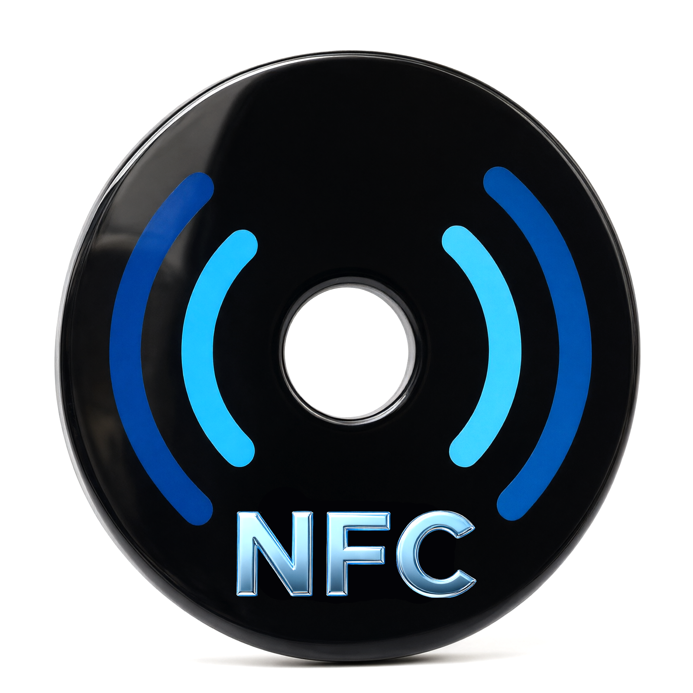

# NFC/Spool

**[English version](README_en.md)**

<p align="center">
  
</p>

Android-приложение для чтения и записи RFID-меток филамента **самим телефоном** через встроенный NFC. Внешний RFID-ридер не нужен.

Поддерживаются QIDI, OpenSpool, Snapmaker U1, сохранённые метки и импорт/экспорт `.bin`.

## Возможности

- **QIDI**
  - Модели QIDI Plus 4 / Max 4 и QIDI Q2.
  - Чтение и запись MIFARE Classic 1K, блок 4, ключ A `FFFFFFFFFFFF`.
  - Встроенные списки материалов, 24 цвета, производители.
  - Импорт CFG-файла QIDI для собственного списка материалов.
- **OpenSpool**
  - Чтение и запись NTAG215/216 в формате NDEF JSON.
  - Профили **OpenSpool Standard** и **Snapmaker U1**.
  - Версии данных Basic / Standard / All (U1), пресеты материалов и выбор цвета.
  - Дополнительные поля U1: подтип, alpha, температуры стола, вес, диаметр, доп. цвета.
- **Сохранённые метки**
  - Сохранение только по явной кнопке **«Сохранить в данные»**.
  - Автоматическое имя, переименование и удаление.
  - Повторная запись метки из сохранённой записи.
  - Экспорт `.bin` и импорт `.bin` с автоопределением типа по размеру.
- **Snapmaker U1**
  - Настройка host/port и проверка связи по HTTP.
  - Просмотр состояния ToolHead.
  - Отправка данных OpenSpool U1 на принтер по Wi-Fi — **без NFC**.
- **Интерфейс**
  - Русский и английский языки.
  - Проверка доступности NFC и подсказки по работе с метками.
  - Последняя вкладка и выбранные параметры меток запоминаются.

## Что нужно

- Android-смартфон с NFC.
- Для QIDI: **MIFARE Classic 1K**.
- Для OpenSpool и Snapmaker U1: **NTAG215** или **NTAG216**. NTAG213 не поддерживается.
- Для отправки на U1: принтер Snapmaker U1 в той же Wi-Fi сети, HTTP-порт по умолчанию `7125`.

## Как пользоваться

1. Откройте вкладку **«NFC»** и убедитесь, что NFC включён и доступен.
2. Перейдите на вкладку **«Метка»** и выберите **QIDI**, **OpenSpool** или **Snapmaker U1**.
3. Нажмите **«Прочитать метку»** или заполните данные и нажмите **«Записать метку»**.
4. Приложите метку к задней панели телефона рядом с камерой и держите до завершения операции.
5. Чтобы сохранить данные, нажмите **«Сохранить в данные»**. Без этого метка в список не попадёт.
6. Вкладка **«Данные»** содержит сохранённые метки. Оттуда можно записать метку повторно, переименовать или удалить запись, экспортировать `.bin`.
7. Для импорта `.bin` нажмите **«Импорт .bin»** во вкладке «Данные». Поддерживаются QIDI (1024 байта), NTAG215 (540 байт) и NTAG216 (924 байта).
8. Для U1 откройте **«Настройки» → Snapmaker U1**, укажите host/port, сохраните и нажмите **«Проверить»**. Отправка доступна из формы U1 и из сохранённой U1-записи.

Сохранение, работа со списком меток, импорт/экспорт `.bin` и отправка на U1 работают без прикладывания метки.

## Форматы

### QIDI

- Метка: MIFARE Classic 1K.
- Данные: блок 4, 16 байт.
- Байты: `[material_id, color_id, manufacturer_id, 0, ... 0]`.
- Дамп `.bin`: 1024 байта, данные находятся по смещению `4 × 16 = 64`.
- UID и служебные блоки при экспорте заполняются автоматически, если их нет в исходной метке.

### OpenSpool

- Метки: NTAG215 (135 страниц, 504 байта) или NTAG216 (231 страница, 888 байт).
- CC: `E1 10 3E 00` для NTAG215, `E1 10 6D 00` для NTAG216.
- NDEF-запись с MIME `application/json`.
- JSON содержит `protocol: "openspool"`, `version: "1.0"`, тип материала и цвет; для U1 добавляются расширенные поля.
- Пользовательские данные: страницы 4–129 (NTAG215) или 4–225 (NTAG216).
- Дамп `.bin`: 540 байт (NTAG215) или 924 байта (NTAG216).
- NTAG213 не поддерживается.

### QIDI CFG

Импортируется текстовый конфигурационный файл с секциями `[filaN]` и полями вроде `filament`, `type`, `min_temp`, `max_temp`, `box_min_temp`, `box_max_temp`. Импортированный список заменяет встроенный до сброса CFG в настройках.

## Настройки

- **Язык / Language** — русский или английский.
- **QIDI CFG** — импорт `.cfg` и сброс к встроенным спискам.
- **Snapmaker U1** — host, port и проверка ToolHead.

Ручное редактирование встроенных списков материалов и производителей пока не реализовано; для QIDI используется импорт CFG.

## Технологии

- Flutter / Dart, Material 3.
- `flutter_nfc_kit` — NFC, MIFARE Classic и raw-команды NTAG.
- `provider` — состояние приложения.
- `shared_preferences` — настройки и выбранные параметры.
- `path_provider` — локальное хранение записей.
- `file_picker` — импорт и экспорт файлов.
- `http` — запросы к Snapmaker U1.
- `url_launcher` — ссылка на репозиторий.

Данные хранятся локально на телефоне. Сеть используется только для обращения к Snapmaker U1.

## Структура проекта

```text
lib/
  core/
    nfc/                 NFC-транспорт и проверка доступности
    utils/               hex/BCC-утилиты
  data/
    qidi/                модели, списки, CFG и .bin QIDI
    openspool/           модели, NDEF и .bin OpenSpool
    records/             сохранённые метки
    snapmaker/           настройки и модели U1
  services/              чтение/запись меток, HTTP-клиент U1
  ui/                    экраны: NFC, метка, данные, настройки
  l10n/                  русско-английские переводы
```

## Сборка

Проект собирается стандартными средствами Flutter. Release APK подписывается отдельным ключом; параметры подписи и сам ключ хранятся локально и не входят в репозиторий.

```powershell
flutter pub get
flutter analyze
flutter test
flutter build apk --release
```

## Статус и ограничения

- NFC-транспорт проверен на Xiaomi 13T Pro: MIFARE Classic и NTAG читаются/пишутся.
- Поддерживается только Android; iOS-версии нет.
- Нет внешнего RFID-ридера и USB OTG.
- Snapmaker U1 использует HTTP без авторизации; телефон и принтер должны быть в одной сети.
- Приложение не является официальным продуктом QIDI, Snapmaker или OpenSpool.

## Благодарности

- [MIFARE Classic Tool](https://github.com/ikarus23/MifareClassicTool) — ориентир по работе с MIFARE Classic через Android NFC.
- [NFC Tools](https://www.wakdev.com/) — ориентир по raw-командам NTAG.
- [BoxRFID-Touch](https://github.com/TinkerBarn/BoxRFID-Touch) — источник логики и форматов QIDI/OpenSpool; списки и поведение сверены с версией v4.2.1.
- [OpenSpool](https://github.com/spuder/openspool) — документация и спецификация NDEF JSON-формата меток OpenSpool.
- [U1-RFID](https://github.com/DnG-Crafts/U1-RFID) — документация по формату OpenSpool для Snapmaker U1 и протоколу официальных U1-меток.

Спасибо авторам и участникам этих проектов за открытые материалы.

## Лицензия

Проект распространяется под **GNU General Public License v3.0**. Полный текст лицензии — в файле [LICENSE](LICENSE).
